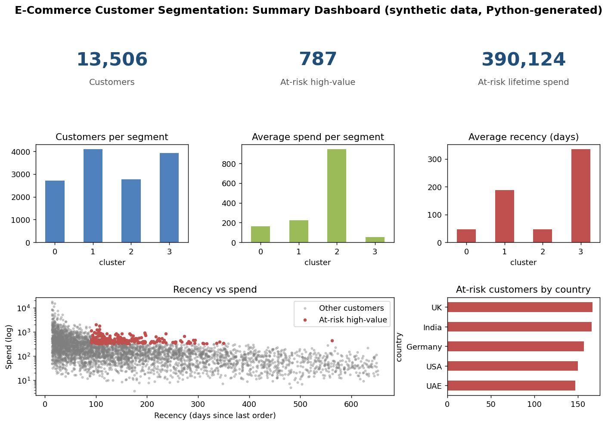

# E-Commerce Customer Segmentation (RFM)

Segments e-commerce customers with RFM (Recency, Frequency, Monetary) analysis so marketing can replace generic email blasts with targeted offers, and finds high-value customers who are at risk of churning.

> **Data notice:** This repository uses a **synthetic database** created by `generate_data.py`. It contains no real company or customer data, and all results are illustrative.

## Business problem

The marketing team sends the same email to everyone. They want to target high-value customers with tailored offers and run a win-back campaign for valuable customers who have gone quiet.

## Approach

1. **Extract with SQL:** join `customers` and `orders` with a CTE, aggregating per customer with `GROUP BY` (`sql/rfm_extract.sql`).
2. **Score RFM:** quintile scores (1 to 5) for recency, frequency and monetary value.
3. **Segment:** K-Means clustering (scikit-learn) on log-scaled R, F and M values gives four behavioural segments.
4. **Flag at-risk high-value customers:** top-quartile spenders with no purchase in the last 90 days.
5. **Report:** CSV outputs load straight into Power BI.

## Project structure

```
.
├── generate_data.py          # synthetic SQLite database (~100k+ records)
├── rfm.py                    # scoring, clustering, at-risk list
├── make_dashboard.py         # static summary dashboard image
├── sql/rfm_extract.sql
├── requirements.txt
├── data/                     # generated database (git-ignored)
└── output/                   # generated CSVs and chart (git-ignored)
```

## How to run

```bash
python -m venv .venv && source .venv/bin/activate   # Windows: .venv\Scripts\activate
pip install -r requirements.txt
python generate_data.py
python rfm.py
python make_dashboard.py   # optional: summary image
```

## Outputs

- `output/rfm_customers_for_powerbi.csv`: one row per customer with R, F, M, score, cluster and an at-risk flag.
- `output/at_risk_high_value_customers.csv`: the win-back target list, sorted by spend.
- `output/segments.png`: customers per segment.

## Summary dashboard image

`make_dashboard.py` creates a static summary image with matplotlib. It is a Python visual, **not a Power BI report**.



## Power BI dashboard

Load `rfm_customers_for_powerbi.csv` and build: a segment summary (customers, average spend, average recency), a table of at-risk customers with a country slicer, and a card showing at-risk lifetime spend. Suggested DAX:

```
At Risk Spend = CALCULATE(SUM(rfm[monetary]), rfm[at_risk_high_value] = 1)
Avg Recency = AVERAGE(rfm[recency_days])
```

## Tools

SQL (joins, CTEs, GROUP BY), Python (pandas, NumPy, scikit-learn, matplotlib), Power BI.

## License

MIT, see [LICENSE](LICENSE).
